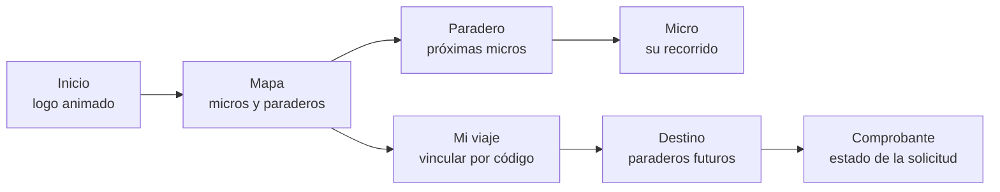
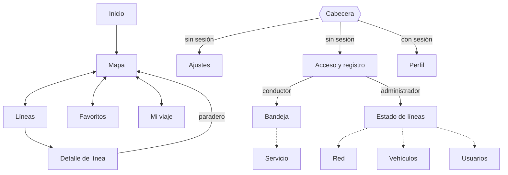

# Flujo de la Aplicación — VoyBus

> Recorridos del usuario, pantallas, navegación e interacciones. Cita las funciones del [TRD](TRD.md) (F1…).
> Pantallas S1…, recorridos J1…. Las pantallas marcadas «pendiente» corresponden a requisitos de la ERS aún no implementados.

## 01 · Resumen

| Campo | Valor |
|---|---|
| Nombre del producto | VoyBus |
| Propósito | Consultar la red de micros de Antofagasta, ver micros y paraderos en el mapa y pedir una parada a bordo |
| Usuarios objetivo | Pasajeros (con o sin cuenta), conductores y administradores |
| Plataformas | iOS y Android con Expo Go; web |
| Versión | v3 (Costa claro / Pulso oscuro), rama `codex/rediseno-movilidad` |

## 02 · Flujo principal del pasajero (J1)

| Paso | Qué hace el usuario | Pantalla | Funciones |
|---|---|---|---|
| 1 | Abre la app: la marca entra animada mientras carga la sesión | S1 | — |
| 2 | Ve el mapa; al acercarse aparecen micros y paraderos | S2 | F7 |
| 3 | Busca o toca un paradero y ve las micros que aún pasarán | S2 | F7 |
| 4 | Toca una próxima micro: el mapa se acerca y muestra solo su recorrido | S2 | F7 |
| 5 | Ya a bordo, ingresa (o crea cuenta) y vincula el código del bus | S9, S6 | F1, F2, F8 |
| 6 | Elige dónde bajar y envía la solicitud | S6 | F9 |
| 7 | Sigue el estado en el comprobante | S6 | F10 |

## 03 · Pantallas clave

| # | ID | Pantalla | Propósito | Elementos principales | Funciones |
|---|---|---|---|---|---|
| 1 | S1 | Inicio | Marca y carga de sesión | Logo «V voybus» animado | — |
| 2 | S2 | Mapa | Micros, paraderos y ubicación | Mapa, Mi ubicación, panel con buscador, contexto, filtro por línea, lista | F7 |
| 3 | S3 | Líneas | Catálogo con estado | Ilustración de la costa, búsqueda, filtro de estado, filas por línea | F4 |
| 4 | S4 | Detalle de línea | Recorridos y paraderos | Selector de recorrido, paraderos en orden, favorito | F5, F6, F12 |
| 5 | S5 | Favoritos | Líneas y recorridos guardados | Lista, quitar, sincronizar | F12 |
| 6 | S6 | Mi viaje | Vincular, destino y comprobante | Pasos 1-2-3, código, destinos, comprobante | F8–F10 |
| 7 | S7 | Perfil | Cuenta del usuario | Avatar, menú: Mi perfil, Favoritos, Historial, Preferencias, Privacidad, Seguridad, Salir | F3, F13–F15 |
| 8 | S8 | Ajustes (sin sesión) | Apariencia sin cuenta | Idioma, tema, Ingresar | F14 |
| 9 | S9 | Acceso y registro | Ingresar o crear cuenta | Correo, contraseña, foto opcional | F1, F2 |
| 10 | S10 | Bandeja del conductor | Solicitudes del servicio | Servicio, destinos, comprobantes | F11 |
| 11 | S11 | Estado de líneas | Administración del estado | Estado por línea, automático/manual, último cambio | F16 |
| 12 | S12 | Servicio del conductor (pendiente) | Iniciar y cerrar servicio | Vehículo, recorrido, iniciar, cerrar | F19 |
| 13 | S13 | Gestión de red (pendiente) | Líneas, recorridos, paraderos | Listas, formularios, desactivar | F21 |
| 14 | S14 | Vehículos (pendiente) | Patentes y códigos | Lista, formulario, activar/desactivar | F22 |
| 15 | S15 | Usuarios (pendiente) | Cuentas y roles | Lista, crear conductor, rol, activar/desactivar | F23 |

Estados por pantalla:
- **Listas (S3, S4, S5, S7 historial, S10, S11):** esqueletos si la carga supera 300 ms, «Sigue cargando…» después de 3 s, vacío con explicación y error con reintento (spinner en el botón).
- **S2:** aviso «Acércate…» con zoom lejano; panel contraíble; ubicación con carga, permiso denegado y «Abrir ajustes», GPS apagado y fuera de Antofagasta; aviso de desvío en la 129.
- **S6:** código inválido, sin servicio activo, envío incierto con reintento idempotente; con F17 y F18, «Cancelar solicitud» (solo pendiente) y «Bajarme de este bus» (sin solicitud activa).
- **S10:** sin servicio asignado; con F20, «Reconocer» y «Atendida» por solicitud.

## 04 · Flujos adicionales

| ID | Flujo | Qué cubre | Pantallas |
|---|---|---|---|
| J2 | Explorar la red | Líneas → detalle → paradero → «ver en el mapa» abre ese paradero en S2 | S3, S4, S2 |
| J3 | Cuenta | Registro, foto inicial, ingreso, perfil, contraseña, salir | S9, S7 |
| J4 | Preferencias | Idioma y tema con o sin cuenta; avisos con cuenta | S8, S7 |
| J5 | Favoritos | Guardar sin sesión (aviso) y copiar a la cuenta al ingresar | S4, S5 |
| J6 | Conductor | Bandeja; con F19 iniciar y cerrar servicio; con F20 reconocer y atender | S10, S12 |
| J7 | Administración | Estado de líneas; con F21–F23 red, vehículos y usuarios | S11, S13–S15 |
| J8 | Cancelar o bajarse (pendiente) | Cancelar una solicitud pendiente y desvincularse | S6 |

## 05 · Navegación

La barra inferior (Mapa, Líneas, Favoritos, Mi viaje) es del pasajero o visitante. El conductor ve su bandeja y el administrador su panel. Las líneas punteadas son pantallas pendientes.

## 06 · Transiciones y movimiento

- **Inicio (S1):** la «V» entra con un resorte y líneas de velocidad, las letras caen escalonadas con un pequeño rebote, pulso y salida «atravesando» la pantalla (~2,4 s, una vez por apertura). Si la carga se alarga, la marca respira.
- **Cambio de pestaña:** fundido con desplazamiento corto (180 ms) e indicador que se desplaza.
- **Scroll:** línea de recorrido con una micro que avanza bajo la cabecera; paralaje en la ilustración de la costa; filas y paraderos que aparecen al entrar en pantalla.
- **Panel del mapa:** sigue el dedo y se asienta en 320 ms con curva de cajón; micros y paraderos aparecen con fundido según el zoom.
- **Acciones:** escala de 0,97 al presionar; spinner en el botón que espera al servidor sin cambiar su tamaño.
- **Movimiento reducido:** sin desplazamientos ni escalas; solo fundidos o cambio inmediato.
